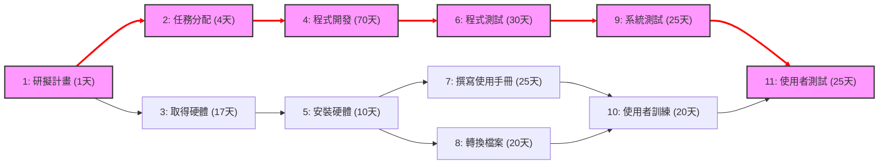

# 個人作業 2

## 一、任務清單與時程

| 任務 | 說明 | 工期 (天) | 前置任務 |
| :---: | :--- | :---: | :---: |
| **1** | 研擬計畫 | 1 | - |
| **2** | 任務分配 | 4 | 1 |
| **3** | 取得硬體 | 17 | 1 |
| **4** | 程式開發 | 70 | 2 |
| **5** | 安裝硬體 | 10 | 3 |
| **6** | 程式測試 | 30 | 4 |
| **7** | 撰寫使用手冊 | 25 | 5 |
| **8** | 轉換檔案 | 20 | 5 |
| **9** | 系統測試 | 25 | 6 |
| **10** | 使用者訓練 | 20 | 7, 8 |
| **11** | 使用者測試 | 25 | 9, 10 |

---

## 二、關鍵路徑 (Critical Path)
* **專案總工期**：155 天
* **關鍵路徑**：`1 → 2 → 4 → 6 → 9 → 11`

---

## 三、圖表表示

### 1. PERT / CPM 網路圖


### 2. 甘特圖 (Gantt Chart)
```mermaid
gantt
    title 專案甘特圖 (Gantt Chart)
    dateFormat  X
    axisFormat %s 天

    section 關鍵路徑任務
    1 研擬計畫        :crit, active, t1, 0, 1d
    2 任務分配        :crit, active, t2, after t1, 4d
    4 程式開發        :crit, active, t4, after t2, 70d
    6 程式測試        :crit, active, t6, after t4, 30d
    9 系統測試        :crit, active, t9, after t6, 25d
    11 使用者測試     :crit, active, t11
