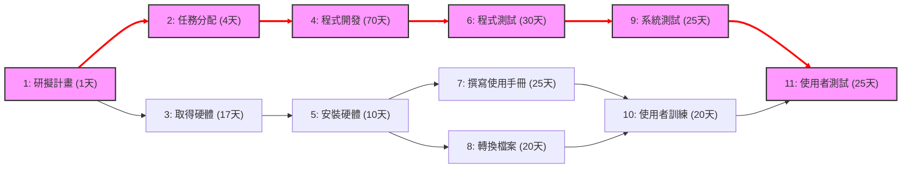

# 個人作業 2

## 一、任務時程與關鍵路徑分析

### 1. 各任務時間與浮動時間表
* **ES (Earliest Start)**：最早開始時間
* **EF (Earliest Finish)**：最早完成時間
* **LS (Latest Start)**：最晚開始時間
* **LF (Latest Finish)**：最晚完成時間
* **Float (Slack)**：總浮動時間

| 任務 | 說明 | 需時(天) | 前置任務 | 最早開始(ES) | 最早完成(EF) | 最晚開始(LS) | 最晚完成(LF) | 浮動時間 | 關鍵路徑 |
| :---: | :--- | :---: | :---: | :---: | :---: | :---: | :---: | :---: | :---: |
| **1** | 研擬計畫 | 1 | - | 0 | 1 | 0 | 1 | 0 | **是** |
| **2** | 任務分配 | 4 | 1 | 1 | 5 | 1 | 5 | 0 | **是** |
| **3** | 取得硬體 | 17 | 1 | 1 | 18 | 33 | 50 | 32 | 否 |
| **4** | 程式開發 | 70 | 2 | 5 | 75 | 5 | 75 | 0 | **是** |
| **5** | 安裝硬體 | 10 | 3 | 18 | 28 | 50 | 60 | 32 | 否 |
| **6** | 程式測試 | 30 | 4 | 75 | 105 | 75 | 105 | 0 | **是** |
| **7** | 撰寫使用手冊 | 25 | 5 | 28 | 53 | 60 | 85 | 32 | 否 |
| **8** | 轉換檔案 | 20 | 5 | 28 | 48 | 65 | 85 | 37 | 否 |
| **9** | 系統測試 | 25 | 6 | 105 | 130 | 105 | 130 | 0 | **是** |
| **10** | 使用者訓練 | 20 | 7, 8 | 53 | 73 | 85 | 105 | 32 | 否 |
| **11** | 使用者測試 | 25 | 9, 10 | 130 | 155 | 130 | 155 | 0 | **是** |

### 2. 關鍵路徑 (Critical Path)
* **專案總工期**：155 天
* **關鍵路徑**：`1 → 2 → 4 → 6 → 9 → 11`

---

## 二、圖表表示

### 1. PERT / CPM 網路圖

### 2. 甘特圖 (Gantt Chart)

```mermaid
gantt
    title 專案甘特圖 (Gantt Chart)
    dateFormat  X
    axisFormat %s 天

    section 關鍵路徑任務
    1 研擬計畫        :crit, active, t1, 0, 1d
    2 任務分配        :crit, active, t2, after t1, 4d
    4 程式開發        :crit, active, t4, after t2, 70d
    6 程式測試        :crit, active, t6, after t4, 30d
    9 系統測試        :crit, active, t9, after t6, 25d
    11 使用者測試     :crit, active, t11, after t9, 25d

    section 非關鍵路徑任務
    3 取得硬體        :t3, after t1, 17d
    5 安裝硬體        :t5, after t3, 10d
    7 撰寫使用手冊    :t7, after t5, 25d
    8 轉換檔案        :t8, after t5, 20d
    10 使用者訓練     :t10, after t7, 20d
```

